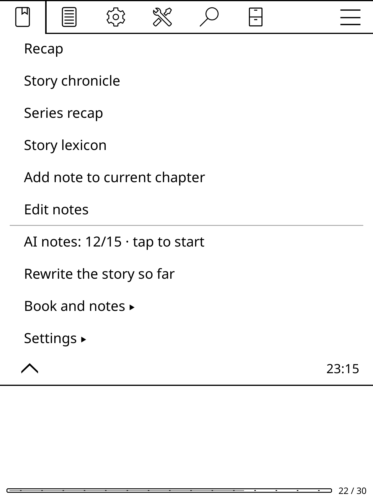
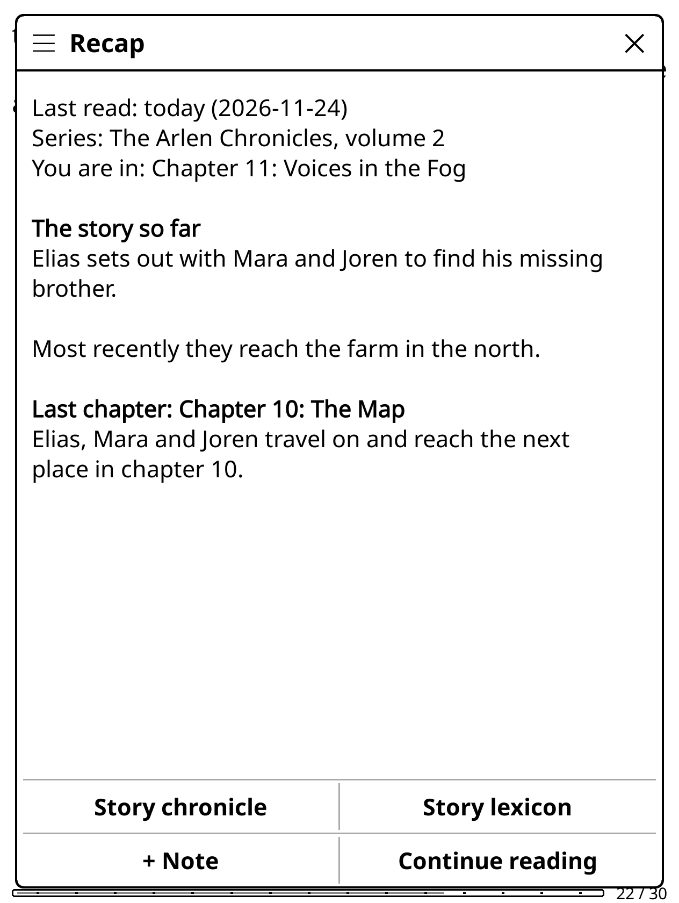
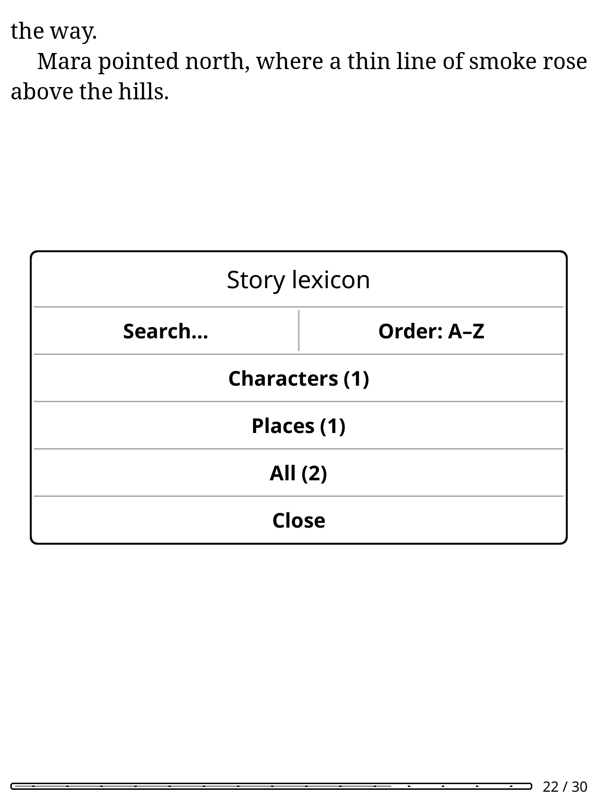
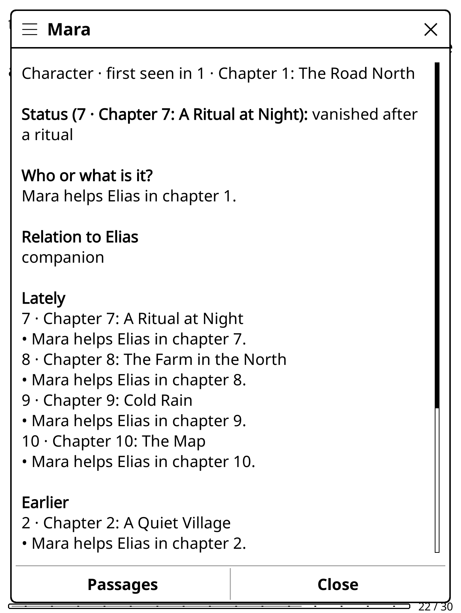
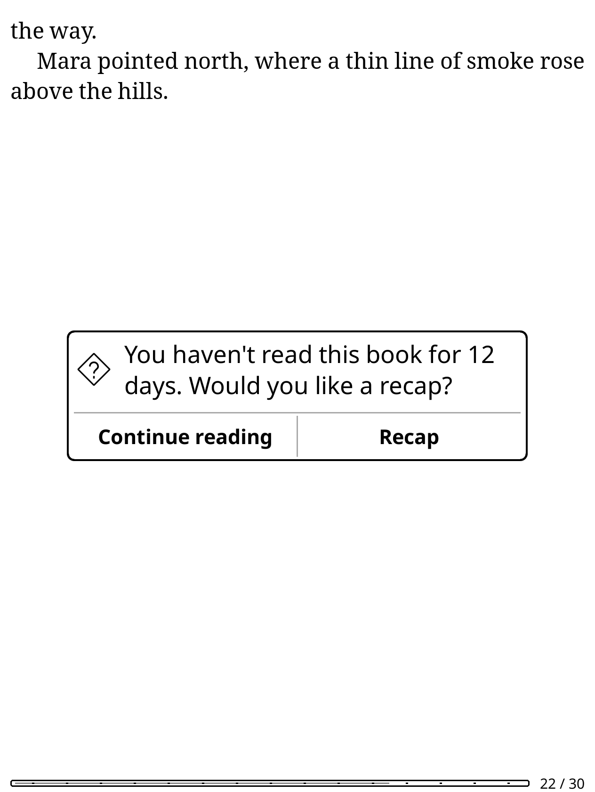
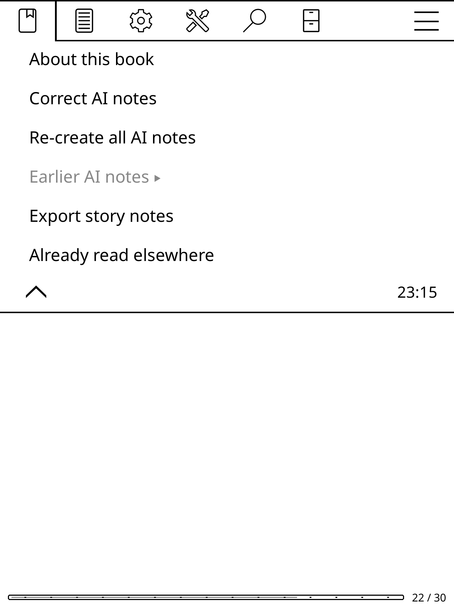
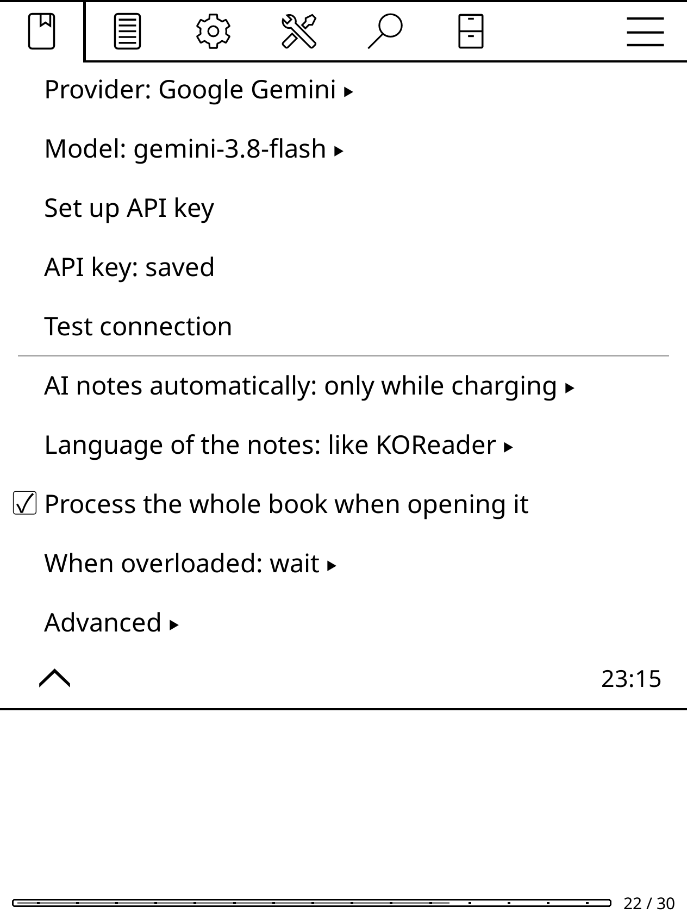

# Story Recall für KOReader

*English: [README.md](README.md)*

<!-- lang-note -->
*Funktioniert auf **Deutsch und Englisch**: Menüs und Texte richten sich nach der KOReader-Sprache.*

Ein KOReader-Plugin, das dich spoilerfrei an die bisherige Geschichte erinnert, genau bis zu deiner Stelle im Buch.

> **Stand: Beta (0.9.9).** Alle automatischen Tests bestehen unter Linux. Auf dem Kobo mit echten Gemini- und Claude-Anfragen getestet. Die anderen KI-Anbieter sind mit echten Anfragen noch nicht ausprobiert.

## Bildschirmfotos

*Die Bildschirmfotos zeigen die englische Oberfläche; in einem deutschen KOReader sind die Texte deutsch.*

<table>
<tr><td align="center" valign="top" width="33%"> Hauptmenü</td><td align="center" valign="top" width="33%"> Rückblick: die Geschichte bisher, bis zu deiner Stelle</td><td align="center" valign="top" width="33%"> Story-Lexikon: Kategorien</td></tr>
<tr><td align="center" valign="top" width="33%"> Ein Lexikon-Eintrag mit Zustand, Beziehung und Verlauf</td><td align="center" valign="top" width="33%"> Angebot eines Rückblicks nach einer Pause</td><td align="center" valign="top" width="33%"> Untermenü Buch und Notizen</td></tr>
<tr><td align="center" valign="top" width="33%"> KI-Einstellungen</td></tr>
</table>

## Was es kann

- **Rückblick nach einer Pause:** Öffnest du ein Buch nach einigen Tagen wieder, siehst du, was bisher geschah und wo die Geschichte gerade steht.
- **Story-Chronik:** Alle gelesenen Kapitel mit kurzer Zusammenfassung und deinen eigenen Notizen, dazu ein Sprung zu jedem Kapitel.
- **Reihen-Rückblick:** Beim Start eines neuen Bandes erfährst du, was in den vorherigen Bänden passiert ist.
  - Die Zusammenfassung jedes Bandes wird zusätzlich in einem Reihen-Archiv gesichert. Gelöschte Bücher bleiben also im Rückblick.
  - Hast du einen Band woanders gelesen, zum Beispiel auf Papier, kannst du ihn als „Schon woanders gelesen“ markieren.
  - Hast du die früheren Bände gar nicht digital, kann die KI sie aus dem Internet zusammenfassen. Das ist deutlich gekennzeichnet und zeigt die Quellen.
  - Übersetzungen mit anderem Reihennamen werden einmal nachgefragt und danach verknüpft.
  - Die Zusammenfassung eines fertig gelesenen Bandes entsteht in einer eigenen Anfrage (Handlung, Figuren, Stand am Ende). Im ☰ des Reihen-Rückblicks lässt sie sich neu schreiben.
- **Wer war das noch mal?** Einen Namen markieren und „Story-Kontext“ antippen. Du siehst, wer das ist, die Beziehung zur Hauptfigur und alles Bisherige, auf Wunsch auch die Textstellen. Das **Story-Lexikon** listet alle Figuren, Orte, Gegenstände und Gruppen nach Kategorien. Suche über alle Kategorien (findet sie nichts, kann die KI in den gelesenen Kapiteln nachsehen), Sortierung A–Z, nach Häufigkeit oder nach letztem Auftreten.
- **Geschichte bisher neu schreiben:** ein frischer Überblick aus allen Kapitel-Zusammenfassungen, eine Anfrage.
- **Eigene Notizen** zu jedem Kapitel.
- **KI-Notizen korrigieren:** Du kannst Zusammenfassungen von Hand verbessern, das Original bleibt erhalten.
- **Frühere KI-Notizen:** Erstellst du die KI-Notizen neu (z. B. mit einem anderen Anbieter), bleibt der alte Stand aufgehoben, bis zu zwei pro Anbieter. Du kannst ohne neue Anfragen zurückwechseln.
- **Export** als Markdown-Datei neben dem Buch.
- **ZenOS-Einbindung:** Home-Widget, Aktionen für Controls, Navbar und Launcher, Knopf im Markieren-Menü. Das Plugin funktioniert auch ohne ZenOS.
- **Sprache der Notizen:** Standardmäßig in der Sprache von KOReader, auch bei englischen Büchern. Alternativ in der Sprache des Buches.

Nichts zeigt mehr als das, was du gelesen hast. Wer im Inhaltsverzeichnis vorspringt, schaltet dadurch nichts frei.

## KI und Datenschutz

Die Kapitel-Notizen erstellt eine KI deiner Wahl:
- Google Gemini (mit kostenlosem Kontingent)
- Claude
- OpenAI
- OpenRouter
- Mistral
- DeepSeek
- ein eigener OpenAI-kompatibler Dienst

**Getestet sind bisher nur Google Gemini und Claude** mit echten Anfragen. Die anderen Anbieter sind nach ihrer Dokumentation eingebaut, aber noch nicht mit echten Anfragen getestet. Rückmeldungen dazu sind willkommen.

Jedes Kapitel wird **einmal** verschickt. Danach funktioniert alles offline auf dem E-Reader, ein Heimcomputer ist nicht nötig. Der API-Schlüssel bleibt auf dem Gerät und geht nur an den gewählten Anbieter. Beim kostenlosen Gemini-Zugang darf Google die Texte zum Training verwenden.

Wissen über Figuren wird nur ergänzt, nie gekürzt oder überschrieben.

Ist der Anbieter überlastet, wartet das Plugin standardmäßig und versucht es später mit demselben Modell weiter. Auf Wunsch wechselt es nach drei Fehlversuchen zu einem anderen Modell. Was ein Buch ungefähr kostet und wie man spart, steht in der Anleitung (Einstellungen → Wie funktioniert das?).

## Installieren

1. Die ZIP-Datei unter [Releases](../../releases) herunterladen und entpacken, oder dieses Projekt herunterladen.
2. Den Ordner **`storyrecall.koplugin`** in KOReaders `plugins`-Ordner kopieren. Auf dem Kobo ist das `.adds/koreader/plugins/`.
3. KOReader neu starten und ein Buch öffnen. Eine kurze Anleitung erscheint.
4. **Werkzeuge → Story Recall → Einstellungen → KI → API-Schlüssel einrichten:** Den QR-Code mit dem Handy scannen und den Schlüssel einfügen.
5. „Jetzt starten“ antippen. Standardmäßig arbeitet das Plugin danach von selbst weiter, wenn das Gerät am Ladekabel hängt.

Mehr zur Bedienung steht in [`storyrecall.koplugin/README.md`](storyrecall.koplugin/README.md).

## Tests

In `tests/` liegen KOReader-Test-Patches (`2-storyrecall-*.lua`), Einzeltests ohne KOReader (`unit_*.lua`) und Skripte zum Erzeugen der Testbücher. In `testbooks/` liegen zwei erzeugte, rechtefreie Bücher. Für jeden Test **einen** Patch nach `patches/` im KOReader-Ordner kopieren. Den ganzen Ablauf zeigt `tests/run_tests_mac.sh`.

## Wer das gemacht hat

Der Code wurde vollständig von **Claude** geschrieben, einer KI von Anthropic. Geschrieben wurde er in Claude Code auf einem Mac, mit Code-Review und Tests durch ein zweites Claude unter Windows/Linux. Der Inhaber dieses Projekts hatte die Idee, hat das Plugin getestet und Rückmeldungen gegeben, aber keinen Code geschrieben.

Es gibt keine Garantie und keinen festen Support. Fehlermeldungen sind als [Issue](../../issues) willkommen. Bitte die `crash.log` aus dem KOReader-Ordner anhängen und vorher prüfen, dass kein API-Schlüssel darin steht.

## Danksagung

Die Anbindung der KI-Anbieter ist vom KOReader-Plugin [X-Ray](https://github.com/ultimatejimmy/xray.koplugin) inspiriert.

## Weitere Plugins

- [Comic Display](https://github.com/Akrota/koreader-comic-display): Refresh gegen Ghosting, dunkle Ränder und Uhr für Comics
- [Levels / Tonwerte](https://github.com/Akrota/koreader-comic-levels): Tonwertkurve für Comics
- [Comic Panel Zoom](https://github.com/Akrota/koreader-comic-panel-zoom): Panel-für-Panel-Ansicht (Fork von JorgeTheFox)
- [Comic Dual Page](https://github.com/Akrota/koreader-comic-dual-page): Doppelseiten mit Erkennung (Fork von KORComic)
- [CBZ Converter](https://github.com/Akrota/koreader-cbz-converter): Comics, PDF und EPUB auf dem Gerät in CBZ umwandeln
- [Folder to series](https://github.com/Akrota/koreader-folder-to-series): Comic-Ordner zu Reihen mit Bandnummern
- [Drive Library](https://github.com/Akrota/koreader-drive-library): Google Drive als Cloud-Bibliothek
- [Guitar Tab Reader](https://github.com/Akrota/koreader-guitar-tab-reader): Gitarren-Tabs und Chords für E-Ink
- [Wi-Fi while charging](https://github.com/Akrota/koreader-wifi-while-charging): WLAN anlassen, solange das Gerät lädt
- [Zen page browser gesture](https://github.com/Akrota/koreader-zen-page-browser-gesture): Geste für den ZenOS-Seitenbrowser

## Lizenz

[MIT](LICENSE)
