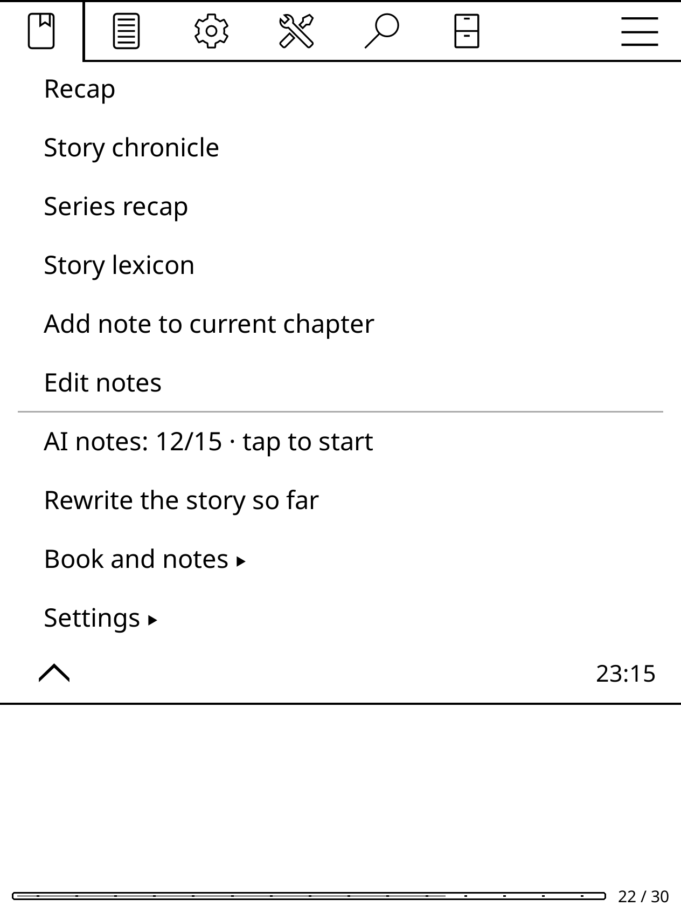
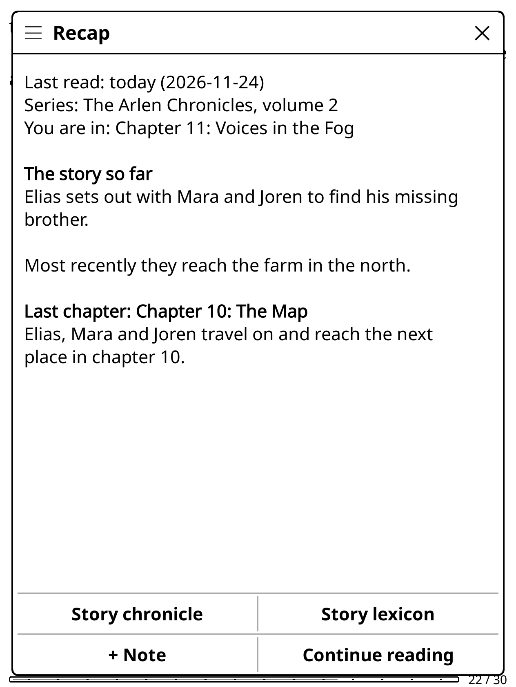
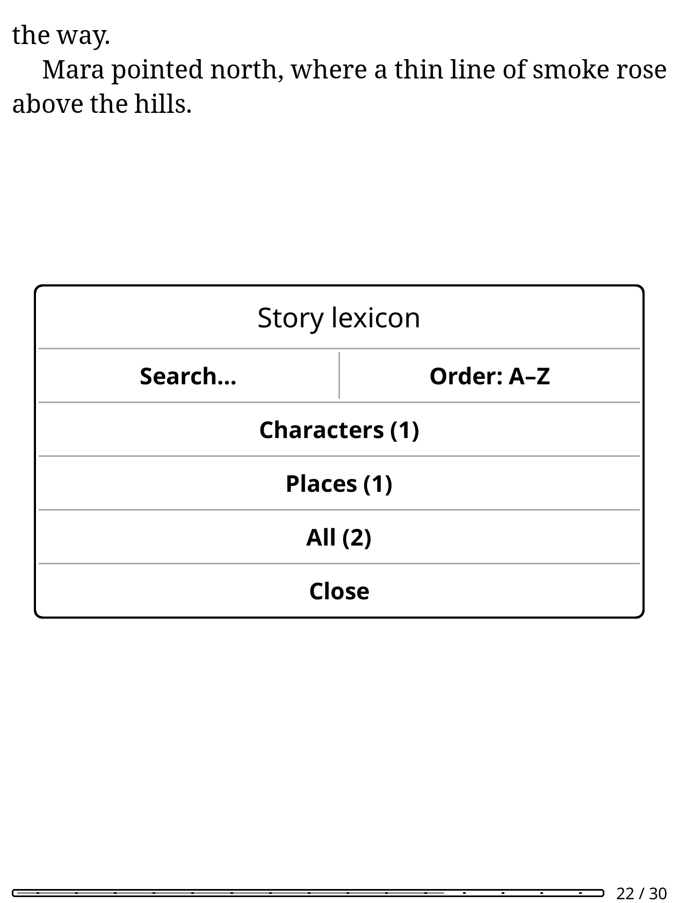
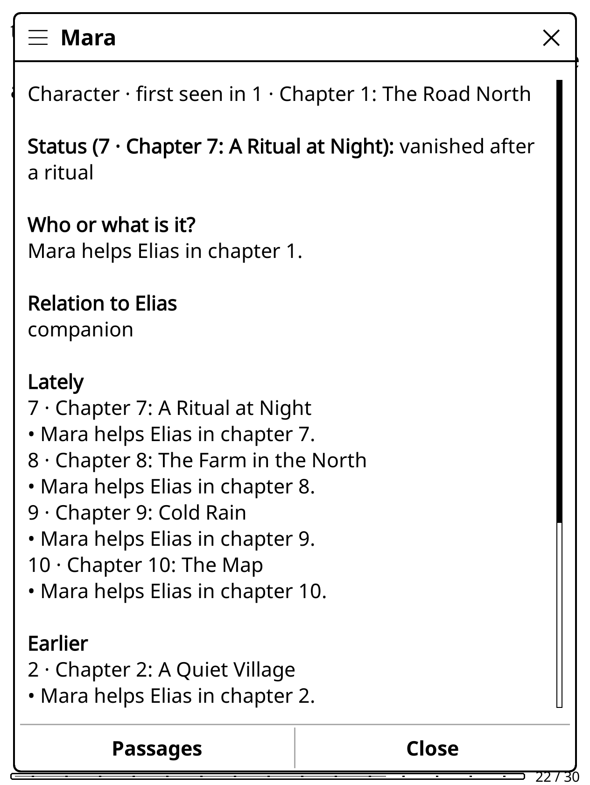
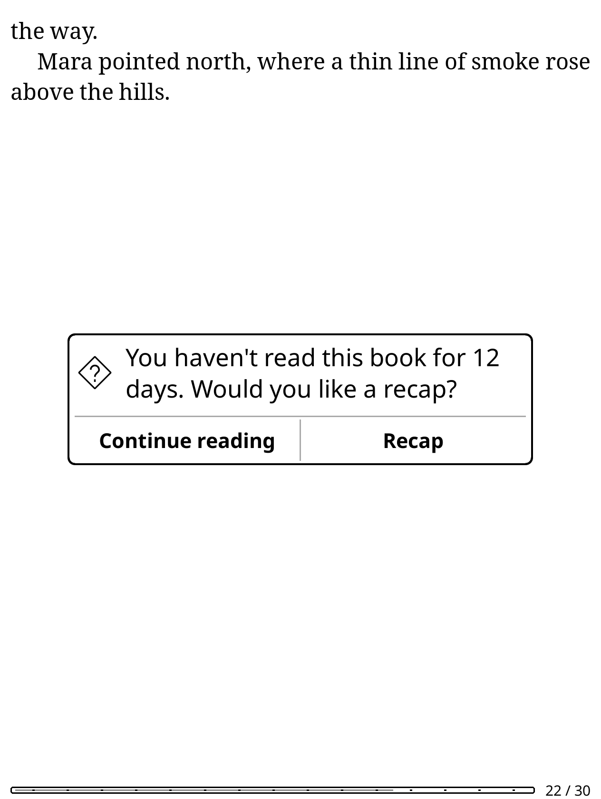
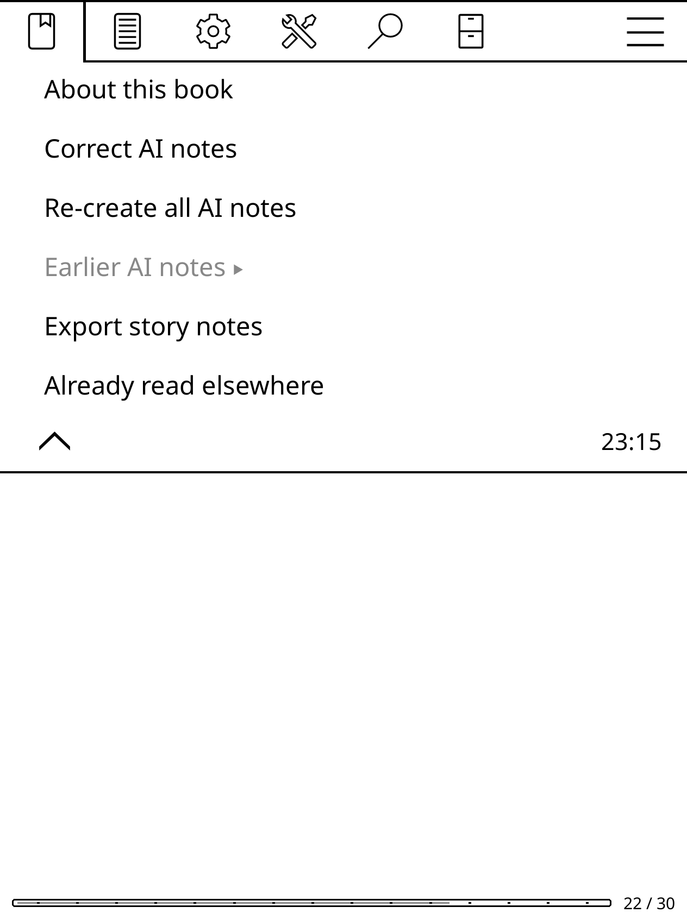
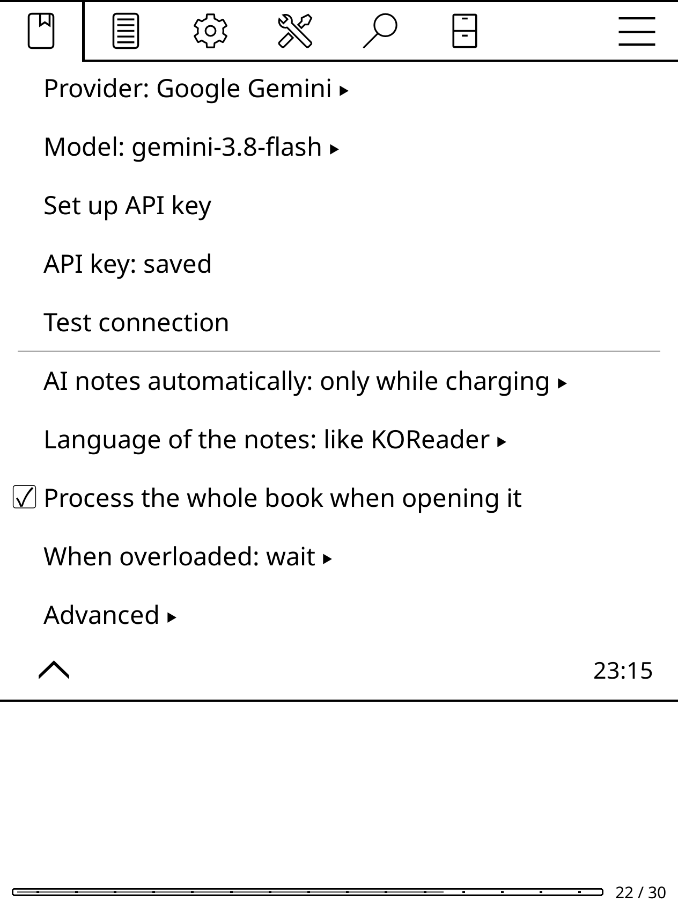

# Story Recall for KOReader

*Deutsch: [README.de.md](README.de.md)*

<!-- byline -->
A plugin by **Akrota and Claude**.

<!-- lang-note -->
*Works in **English and German**: menus and texts follow KOReader's language. A German description is at the bottom of this page.*

A KOReader plugin that reminds you of the story so far, spoiler-free and exactly up to where you are in the book.

> **Status: beta (0.9.9).** All automated tests pass on Linux. Tested on a Kobo with real Gemini and Claude requests. The other AI providers have not been tried with real requests yet.

## Screenshots

*The screenshots show the English interface; in a German KOReader the texts are German.*

<table>
<tr><td align="center" valign="top" width="33%"> Main menu</td><td align="center" valign="top" width="33%"> Recap: the story so far, up to your place in the book</td><td align="center" valign="top" width="33%"> Story lexicon: categories</td></tr>
<tr><td align="center" valign="top" width="33%"> A lexicon entry with status, relation and timeline</td><td align="center" valign="top" width="33%"> Offer of a recap after a break</td><td align="center" valign="top" width="33%"> Book and notes submenu</td></tr>
<tr><td align="center" valign="top" width="33%"> AI settings</td></tr>
</table>

## Features

- **A recap after a break:** if you reopen a book after a few days, you see what has happened so far and where the story stands.
- **Story chronicle:** every chapter you've read, with a short summary and your own notes, plus a jump to each chapter.
- **Series recap:** when you start a new volume, you learn what happened in the previous ones.
  - Each volume's summary is also kept in a series archive, so deleted books stay in the recap.
  - If you read a volume elsewhere, for example on paper, you can mark it as "already read elsewhere".
  - If you don't have the earlier volumes digitally at all, the AI can summarise them from the internet. This is clearly marked and the sources are shown.
  - Translations with a different series name are asked about once and linked from then on.
  - The summary of a finished volume is written in its own request (plot, characters, where things stand). It can be written again from the series recap's ☰ menu.
- **Who was that again?** Select a name and tap "Story context". You see who it is, how they relate to the main character and everything known so far, and the text passages if you want. The **story lexicon** lists all characters, places, objects and groups by category. Search across all categories (if nothing is found, the AI can look it up in the chapters you have read), sort A–Z, by frequency or by last appearance.
- **Rewrite the story so far:** a fresh overview from all chapter summaries, one request.
- **Your own notes** on every chapter.
- **Correcting AI notes:** you can improve summaries by hand, and the original is kept.
- **Earlier AI notes:** if you create the AI notes again (for example with another provider), the old set is kept, up to two per provider. You can switch back without new requests.
- **Export** as a Markdown file next to the book.
- **ZenOS integration:** a Home widget, actions for controls, navbar and launcher, and a button in the highlight menu. The plugin works without ZenOS too.
- **Language of the notes:** KOReader's language by default, even for English books. The book's language is an alternative.

Nothing ever shows more than what you've read. Jumping ahead in the table of contents doesn't unlock anything.

## AI and privacy

The chapter notes are written by an AI of your choice:
- Google Gemini (with a free tier)
- Claude
- OpenAI
- OpenRouter
- Mistral
- DeepSeek
- any OpenAI-compatible service

**Only Google Gemini and Claude have been tested with real requests so far.** The other providers are built from their documentation but not yet tested with real requests. Feedback is welcome.

Each chapter is sent **once**. After that, everything works offline on the e-reader, and no home computer is needed. The API key stays on the device and only goes to the provider you chose. With the free Gemini tier, Google may use the texts for training.

Facts about characters are only ever added, never shortened or overwritten.

If the provider is overloaded, the plugin waits by default and tries again later with the same model. If you like, it switches to another model after three failed attempts. A rough cost estimate per book and saving tips are in the guide (Settings → How does it work?).

## Installation

1. Download the ZIP from [Releases](../../releases) and unpack it, or download this repository.
2. Copy the folder **`storyrecall.koplugin`** to KOReader's `plugins` folder. On a Kobo, that is `.adds/koreader/plugins/`.
3. Restart KOReader and open a book. A short guide appears.
4. Go to **Tools → Story Recall → Settings → AI → Set up API key**, scan the QR code with your phone and paste the key.
5. Tap "Start now". By default, the plugin then keeps working on its own while the device is charging.

More details on usage are in [`storyrecall.koplugin/README.md`](storyrecall.koplugin/README.md).

## Tests

`tests/` contains KOReader test patches (`2-storyrecall-*.lua`), unit tests that run without KOReader (`unit_*.lua`) and scripts to generate the test books. `testbooks/` holds two generated, copyright-free books. For each test, copy **one** patch to KOReader's `patches/` folder. `tests/run_tests_mac.sh` shows the full sequence.

## Who made this

The code was written entirely by **Claude**, an AI by Anthropic (in Claude Code on a Mac, with a code review and tests by a second Claude on Windows/Linux). The owner of this repository came up with the idea, tested the plugin and gave feedback, but did not write the code.

There is no warranty and no guaranteed support. Bug reports are welcome as [issues](../../issues). Please attach `crash.log` from the KOReader folder, and make sure it contains no API keys.

## Acknowledgements

How the AI providers are connected was inspired by the [X-Ray](https://github.com/ultimatejimmy/xray.koplugin) plugin for KOReader.

## More plugins by Akrota and Claude

- [Comic Display](https://github.com/Akrota/koreader-comic-display): Refresh against ghosting, dark borders and a clock for comics
- [Levels / Tonwerte](https://github.com/Akrota/koreader-comic-levels): Tone curve for comics
- [Comic Panel Zoom](https://github.com/Akrota/koreader-comic-panel-zoom): Panel-by-panel view (fork of JorgeTheFox's plugin)
- [Comic Dual Page](https://github.com/Akrota/koreader-comic-dual-page): Double pages with detection (fork of KORComic)
- [CBZ Converter](https://github.com/Akrota/koreader-cbz-converter): Convert comics, PDF and EPUB to CBZ on the device
- [Folder to series](https://github.com/Akrota/koreader-folder-to-series): Comic folders to series with volume numbers
- [Drive Library](https://github.com/Akrota/koreader-drive-library): Google Drive as a cloud library
- [Guitar Tab Reader](https://github.com/Akrota/koreader-guitar-tab-reader): Guitar tabs and chords for e-ink
- [Wi-Fi while charging](https://github.com/Akrota/koreader-wifi-while-charging): Keep Wi-Fi on while charging
- [Zen page browser gesture](https://github.com/Akrota/koreader-zen-page-browser-gesture): Gesture for the ZenOS page browser

## License

[MIT](LICENSE)

---

## Deutsch (Kurzbeschreibung)

Ein KOReader-Plugin, das dich spoilerfrei an die bisherige Geschichte erinnert, genau bis zu deiner Stelle im Buch.

> **Stand: Beta (0.9.9).** Alle automatischen Tests bestehen unter Linux. Auf dem Kobo mit echten Gemini- und Claude-Anfragen getestet. Die anderen KI-Anbieter sind mit echten Anfragen noch nicht ausprobiert.

### Was es kann

- **Rückblick nach einer Pause:** Öffnest du ein Buch nach einigen Tagen wieder, siehst du, was bisher geschah und wo die Geschichte gerade steht.
- **Story-Chronik:** Alle gelesenen Kapitel mit kurzer Zusammenfassung und deinen eigenen Notizen, dazu ein Sprung zu jedem Kapitel.
- **Reihen-Rückblick:** Beim Start eines neuen Bandes erfährst du, was in den vorherigen Bänden passiert ist.
  - Die Zusammenfassung jedes Bandes wird zusätzlich in einem Reihen-Archiv gesichert. Gelöschte Bücher bleiben also im Rückblick.
  - Hast du einen Band woanders gelesen, zum Beispiel auf Papier, kannst du ihn als „Schon woanders gelesen“ markieren.
  - Hast du die früheren Bände gar nicht digital, kann die KI sie aus dem Internet zusammenfassen. Das ist deutlich gekennzeichnet und zeigt die Quellen.
  - Übersetzungen mit anderem Reihennamen werden einmal nachgefragt und danach verknüpft.
  - Die Zusammenfassung eines fertig gelesenen Bandes entsteht in einer eigenen Anfrage (Handlung, Figuren, Stand am Ende). Im ☰ des Reihen-Rückblicks lässt sie sich neu schreiben.
- **Wer war das noch mal?** Einen Namen markieren und „Story-Kontext“ antippen. Du siehst, wer das ist, die Beziehung zur Hauptfigur und alles Bisherige, auf Wunsch auch die Textstellen. Das **Story-Lexikon** listet alle Figuren, Orte, Gegenstände und Gruppen nach Kategorien. Suche über alle Kategorien (findet sie nichts, kann die KI in den gelesenen Kapiteln nachsehen), Sortierung A–Z, nach Häufigkeit oder nach letztem Auftreten.
- **Geschichte bisher neu schreiben:** ein frischer Überblick aus allen Kapitel-Zusammenfassungen, eine Anfrage.
- **Eigene Notizen** zu jedem Kapitel.
- **KI-Notizen korrigieren:** Du kannst Zusammenfassungen von Hand verbessern, das Original bleibt erhalten.
- **Frühere KI-Notizen:** Erstellst du die KI-Notizen neu (z. B. mit einem anderen Anbieter), bleibt der alte Stand aufgehoben, bis zu zwei pro Anbieter. Du kannst ohne neue Anfragen zurückwechseln.

Die ausführliche deutsche Anleitung steht in der [README.de.md](README.de.md).
